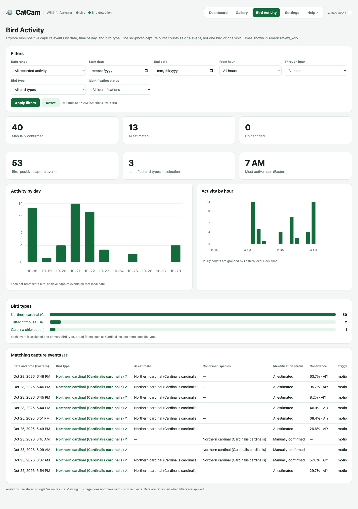

# Bird Activity

**Bird Activity** turns your saved captures into simple charts and tables. It answers questions like:

- When do birds visit?
- Which hours are busiest?
- Which species are showing up?
- How many visits have I confirmed?

Open it from the header: **Bird Activity**.

!!! info "Only bird-positive events appear here"
    Bird Activity counts **bird-positive capture events**. A six-photo burst is one event, not six. Non-bird bursts are not included.

## Filters

| Filter | Options |
| --- | --- |
| **Date range** | All recorded activity, Last 7 days, Last 30 days, Last 90 days, or Custom dates. |
| **Start date / End date** | Used with **Custom dates**. The end date must be on or after the start date. |
| **From hour / Through hour** | Limits results to a time of day. Choose both hours or leave both on **All hours**. |
| **Bird type** | All bird types, or one type. Broad types such as Cardinal include more specific types. |
| **Identification status** | All identifications, Manually confirmed, AI estimated, or Unidentified. |

Press **Apply filters** to refresh. Press **Reset** to clear the filters and show all activity.

Times use the timezone configured in [Settings](settings.md#timezone). The current timezone is shown in the page introduction.

## Summary cards

At the top of the page:

- **Manually confirmed** — events where a person confirmed the species.
- **AI estimated** — events with an AI species estimate that has not been confirmed.
- **Unidentified** — bird-positive events with no species identification.
- **Bird-positive capture events** — total events in the current filter.
- **Identified bird types in selection** — how many distinct bird types appear.
- **Most active hour** — the busiest clock hour in the selection, in the selected timezone.

## Charts

### Activity by day

Each bar is the number of bird-positive events on that local date. Use it to spot busy days, quiet stretches, and seasonal changes.

### Activity by hour

Events grouped by local clock hour. This is the fastest way to find the feeder's rush hour and to decide when to watch.

### Bird types

Each event is assigned **one primary bird type**. Broad categories such as **Cardinal** include more specific types, so the chart stays readable even when the AI is uncertain about the exact species.

## Matching capture events

The table lists the events behind the charts.

| Column | Meaning |
| --- | --- |
| **Date and time** | When the burst was recorded, in the selected timezone. |
| **Bird type** | The primary bird type for the event. |
| **AI estimate** | The species suggested by the AI, if any. |
| **Confirmed species** | The species a person confirmed, if any. |
| **Identification status** | Manually confirmed, AI estimated, or Unidentified. |
| **Confidence** | The AI confidence score, when available. |
| **Trigger** | Whether the burst came from motion or a manual capture. |
| **Event ID** | The folder name for the burst. Useful when comparing with the Gallery. |

## Confirming species from a visit

Bird Activity is for reviewing trends. To confirm or correct a species, open the burst in the [Gallery](gallery.md#confirm-or-correct-a-species). Confirmation updates the charts the next time you apply filters.

## What the numbers do not mean

- **One event is not one bird.** A single bird can trigger several bursts, and several birds can appear in one burst.
- **A visit is not a count of individuals.** CatCam records events, not a census.
- **AI estimates are not confirmations.** Treat them as suggestions until you review the photos.
- **Viewing this page makes no new Google Vision requests.** It reads stored results only.

## A simple routine

1. Open **Bird Activity** once a week.
2. Choose **Last 7 days**.
3. Look at **Activity by hour** to see when birds visit.
4. Filter to **AI estimated** and review a few bursts in the Gallery.
5. Confirm the species you can identify.

Over time, this turns the AI suggestions into a reliable record of your feeder.
