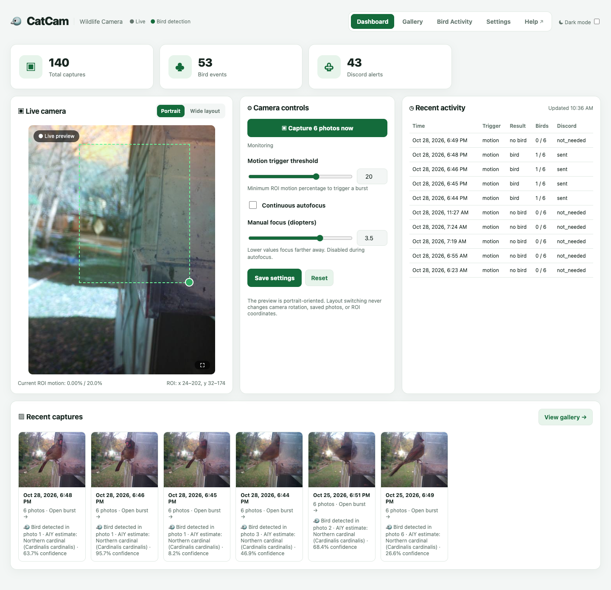
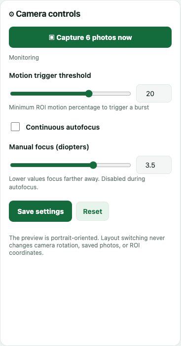
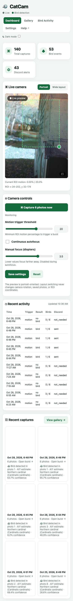

# Dashboard

The Dashboard is CatCam's home page. It shows the live camera, the controls you use most often, recent activity, and the newest captures.

## What is on the page

| Area | What it shows |
| --- | --- |
| **Statistics cards** | Total captures, bird events, and Discord alerts. |
| **Live camera** | The current view, the motion region, and the live motion readout. |
| **Camera controls** | Manual capture, motion threshold, autofocus, and manual focus. |
| **Recent activity** | The latest events with trigger, result, bird photo count, and Discord status. |
| **Recent captures** | Thumbnails of the newest bursts, with an **All / Bird events / No bird** filter. |

## Statistics cards

The three cards at the top summarize the whole history:

- **Total captures** — every burst, whether or not it contained a bird.
- **Bird events** — bursts classified as bird-positive.
- **Discord alerts** — bird bursts sent to Discord.

The **Recent activity** card shows the time it was last refreshed. Statistics refresh when the page loads.

!!! note "Counts are events, not photos"
    A six-photo burst adds **one** to Total captures. A bird-positive burst adds **one** to Bird events, even if several photos contain the bird.

## Live camera

The preview is a live MJPEG stream from the camera. It is intentionally small and efficient so it does not interfere with recording.

### Portrait and Wide layout

Use **Portrait** or **Wide layout** above the preview to change how the dashboard is arranged:

- **Portrait** keeps the preview tall, which suits a phone or a portrait-mounted camera.
- **Wide layout** gives the preview more horizontal room and moves the activity panel below.

This is a **browser preference only**. It does not rotate the camera, change saved photos, or move the motion ROI. Your choice is remembered in that browser.

### Fullscreen

Press the **⛶** button in the bottom-right corner of the preview to fill the screen. Press it again, or press `Esc`, to return.

### Motion readout

Below the preview you will see one of these messages:

| Message | Meaning |
| --- | --- |
| `Current ROI motion: 2.31% / 20.0%` | Live motion inside the ROI and the current trigger threshold. Red means motion is at or above the threshold. |
| `Camera busy — capturing burst…` | CatCam is recording or saving a burst. |
| `Camera stalled — last frame 42s ago` | The camera has stopped producing frames. See [Troubleshooting](troubleshooting.md#the-dashboard-says-camera-stalled). |
| `Camera stalled — no frames yet` | CatCam has not received a frame since it started. |
| `Camera status unavailable` | The browser could not reach the status service. |

The `ROI: x1,y1 – x2,y2` readout shows the saved motion area in camera coordinates. You normally do not need to read it; it is useful when comparing two saved positions.

## Move and resize the motion area

The dashed green box on the preview is the **region of interest (ROI)**.

1. **Drag the box** to move it over the feeder.
2. **Drag the round handle** at its bottom-right corner to resize it.
3. Press **Save settings** under the camera controls.

Only movement inside the box can trigger a burst. A box that is too large catches trees, roads, and people. A box that is too small may miss birds at the edge of the feeder.

!!! tip "The ROI follows the camera, not the layout"
    The ROI is stored against the physical sensor. Switching between Portrait and Wide layout does not change which part of the scene is monitored.

## Camera controls

### Capture 6 photos now

Starts a manual burst immediately, even if motion detection is turned off.

- The button is disabled while the request is sent.
- The status changes to **Capture requested**.
- The new event appears in **Recent activity** and **Recent captures** after the photos are saved.

Manual captures are not limited by the motion cooldown.

### Motion trigger threshold

A slider from **0.5% to 30%** with a matching number box.

- **Lower** — more sensitive; captures smaller movements.
- **Higher** — less sensitive; ignores small changes.

The current value is also shown in the motion readout. Press **Save settings** to keep a change.

### Continuous autofocus

When enabled, the camera continuously adjusts focus. This is the easiest choice when the feeder moves in the wind or birds visit at different distances.

When disabled, the **Manual focus** slider is used. This is useful when the camera and feeder are fixed and you want a consistent focus.

### Manual focus (diopters)

A slider from **0 to 5** with a number box. Lower values focus farther away; higher values focus closer. The control is disabled while Continuous autofocus is on.

Focus is easiest to set with the live preview open: move the slider until the feeder looks sharp, then save.

### Save settings and Reset

- **Save settings** stores the ROI, threshold, autofocus, and focus position on the camera. They survive restarts.
- **Reset** restores the saved values and discards unsaved slider or box changes.

!!! warning "Save before leaving"
    Moving the ROI or changing a slider does not take effect permanently until you press **Save settings**. If you reload the page first, the unsaved change is lost.

## Recent activity

The table lists the newest events:

| Column | Meaning |
| --- | --- |
| **Time** | When the burst was recorded, in the configured timezone. |
| **Trigger** | `motion` or `manual`. |
| **Result** | The classification result, such as `bird`, `no_bird`, `pending`, or `error`. |
| **Birds** | How many of the six photos contain a bird, for example `2 / 6`. |
| **Discord** | Whether an alert was sent, skipped, or failed. |

The **Updated** time in the card header shows when the data was last loaded. Reload the page to refresh it.

## Recent captures

The strip at the bottom shows thumbnails of recent bursts.

- **All** — every recent burst.
- **Bird events** — only bird-positive bursts.
- **No bird** — only bursts without a bird.

Select a thumbnail to open the burst in the [Gallery detail view](gallery.md#open-a-burst). Use **View gallery →** for the full Gallery with date and bird-type filters.

!!! note "Older photos may be unclassified"
    These filters apply to recent database events. Very old photos may have been recorded before classification or may have been removed by cleanup.

## Using CatCam on a phone

The layout adapts to a narrow screen. The header wraps, the statistics become two columns, and the preview and cards stack vertically.

For the best experience, add the dashboard to your home screen so it opens like an app.
