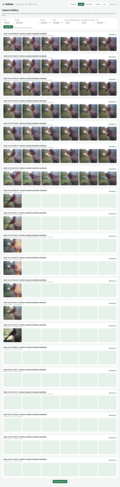
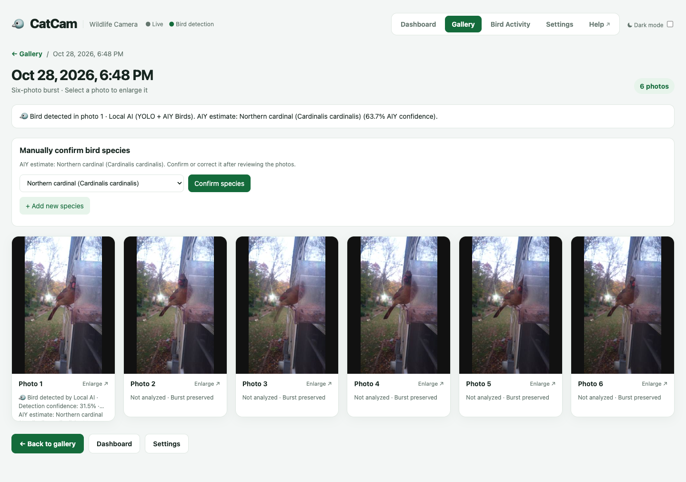

# Gallery & captures

The **Gallery** is the history of every saved burst. Use it to find a visit, compare the six photos, download an original, or confirm which bird was there.

Open it from the header: **Gallery**.

## Browsing bursts

Each card is one burst. The heading shows:

- The **date** and **time** of the burst.
- The **bird type** when one is known, or a result such as **No bird detected**, **Pending classification**, **Classification error**, or **Unclassified**.
- How many **available photos** the burst still has.
- A detection note, such as **Google Vision bird classification**, **AIY estimate: Northern Cardinal · 82.0% confidence · Unreviewed**, or **✓ Confirmed species**.

Select any thumbnail to open that photo, or **Open burst →** to see the whole burst.

!!! note "Why are fewer than six photos shown?"
    Cleanup can remove photos from old non-bird bursts. A card only shows photos that are still available on disk.

## Filters

| Filter | What it does |
| --- | --- |
| **Show** | **All bursts**, **Birds only**, or **No birds**. |
| **Bird type** | Limits results to one bird type. Broad types such as Cardinal include more specific types. |
| **From date / To date** | Limits results to a date range. |
| **From hour / To hour** | Limits results to a time of day in the configured timezone. Choose **both** hours or **neither**. |
| **Sort** | **Newest first** or **Oldest first**. |

Press **Apply filters** to reload the list. The status line shows `Showing X of Y matching bursts`.

- **Show more captures** appears when there are more results. It adds the next page without losing the current list.
- If no bursts match, the page says **No matching captures with photos available.**

!!! tip "The starting filter"
    The Gallery opens with the **Default gallery filter** from [Settings](settings.md#gallery-preferences). The usual default is **Birds only**. Choose **All bursts** to see everything.

### Date and hour rules

- If you choose a **From hour**, you must also choose a **To hour**, and the other way around.
- If you set both dates, the end date must be on or after the start date.
- Hours use the timezone configured in Settings, not the timezone of your phone.

## Open a burst

Select **Open burst →** to see the capture detail page.

The detail page shows:

- The **burst summary** — bird result, engine, and species status.
- All available photos in a grid, each with a short detection description.
- The **Manually confirm bird species** panel.
- Links back to the Gallery and Dashboard.

### View a photo full size

Select a photo to open the viewer.

- Use **‹** and **›** to move between photos.
- On a keyboard, use the **left** and **right arrow** keys.
- Press **Esc** or **✕ Close** to return to the grid.
- **Open original ↗** opens the full-resolution JPEG in a new tab. Use your browser's save command to keep a copy.

The viewer also shows the detection metadata for the selected photo, including any species estimate or confirmation.

## Confirm or correct a species

AI species predictions are **estimates**, not confirmed identifications. Confirming a species improves your records and protects the burst from automatic cleanup.

1. Open the burst.
2. In **Manually confirm bird species**, choose the correct species from the list.
3. Press **Confirm species**.
4. The page shows **✓ Species confirmed: …** and the burst summary updates.

If the AI suggestion is already selected, you still need to press **Confirm species** to record it.

### Remove a confirmation

If you confirmed the wrong bird, press **Remove confirmation**. The AI estimate is kept, but the event is no longer marked as manually confirmed.

### Add a species that is not listed

1. Press **+ Add new species**.
2. Enter the common English name.
3. Press **Save new species**.
4. Select the new species and press **Confirm species**.

!!! info "What confirmation changes"
    A manually confirmed bird is treated as a bird event and is **not eligible for automatic non-bird cleanup**. Confirmation does not create new photos or call Google Vision.

## What the result labels mean

| Label | Meaning |
| --- | --- |
| **Bird** | At least one photo was classified as containing a bird. |
| **No bird detected** | All checked photos were classified as non-bird. |
| **Pending classification** | The burst is saved but detection has not finished. |
| **Classification error** | The detection service could not complete. The event is kept and is not silently retried with another engine. |
| **Unclassified** | An older event with no stored classification result. |
| **AIY estimate** | A species guess from the Local AI service. Not confirmed. |
| **✓ Confirmed species** | A person reviewed the photos and confirmed the species. |

## Downloading photos

- Use **Open original ↗** in the photo viewer to open the full-resolution image.
- Then use your browser's **Save image** or **Download** command.
- The original is the full six-photo-resolution JPEG, not the thumbnail.

## Deleting and retention

There is no delete button in the Gallery. Cleanup runs automatically according to [Storage & cleanup](settings.md#storage-cleanup):

- Only fully classified, non-bird bursts are removed.
- Bird bursts and manually confirmed birds are preserved.
- The retention period defaults to 24 hours.

If disk space is a concern, lower the retention period in Settings. If you want to keep more non-bird bursts, raise it or turn cleanup off.
