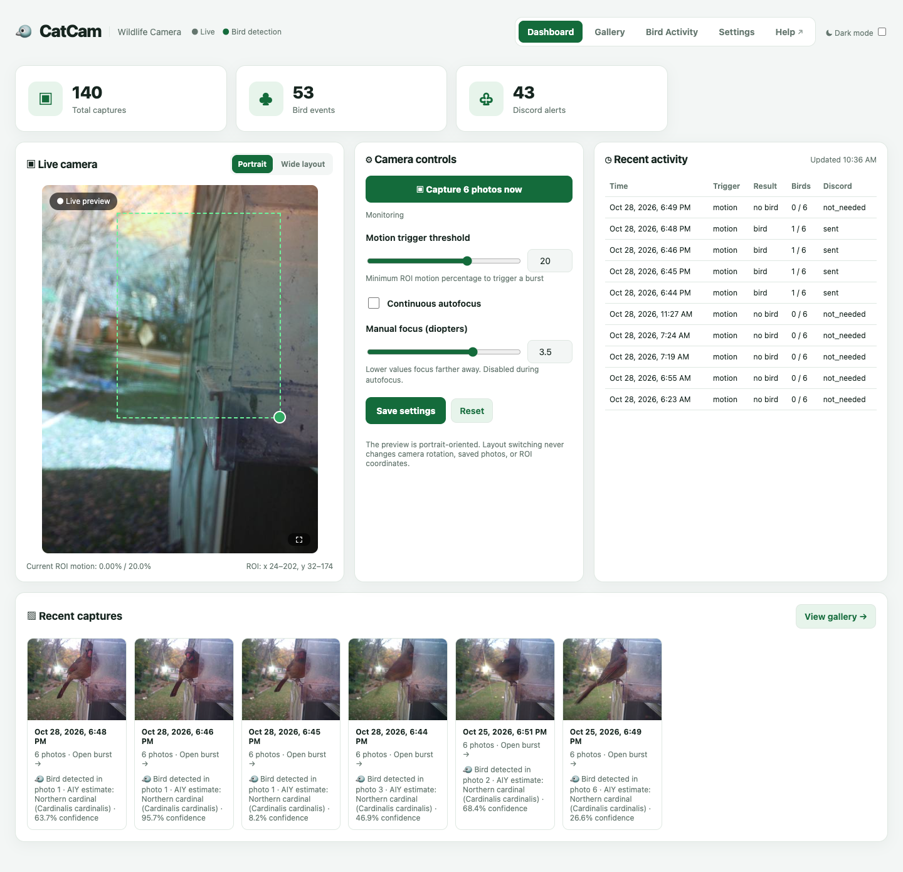
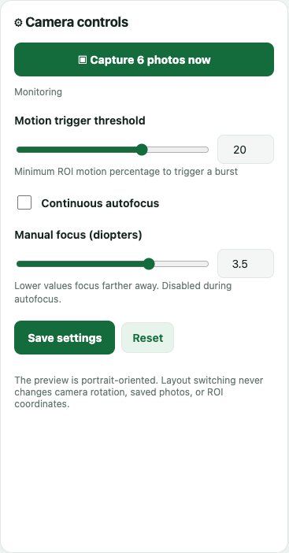

# Getting started

This page takes you from opening CatCam to capturing your first burst.

## Open CatCam

CatCam runs on the camera itself. On a device connected to the same home network, open the address your installer gave you. In the current installation that is:

```text
http://192.168.1.201:8080
```

!!! tip "Make it easy to find"
    Add the address to your phone's home screen, or bookmark it in your browser. CatCam does not require an account or a cloud login.

The Dashboard opens first. The header at the top is shared by every page:

- **CatCam** — returns to the Dashboard.
- **● Live / ● Offline** — shows whether the camera is producing new frames.
- **● Bird detection** — reminds you that classification is active.
- **Dashboard · Gallery · Bird Activity · Settings** — move between the main pages.
- **Help ↗** — opens this guide in a new tab.
- **☾ Dark mode** — switches the interface between light and dark. The choice is remembered in your browser.



## Check that the camera is live

Look at the **Live camera** card:

- The preview should update every second or two.
- The small pill in the corner says **● Live preview**.
- Below the preview, the motion readout shows the current ROI motion and the trigger threshold.

If the preview is frozen or the header says **Offline**, see [Troubleshooting](troubleshooting.md).

## Capture your first burst

1. Open the **Dashboard**.
2. Find the **⚙ Camera controls** card.
3. Press **▣ Capture 6 photos now**.
4. Wait for the status message to change to **Capture requested**. The button is disabled briefly while the burst starts.
5. Watch **Recent activity** or **Recent captures**. A new event appears after the photos are saved and classified.



!!! note "Capturing takes a moment"
    CatCam records six full-resolution photographs. A burst can take several seconds, and classification can take longer. The camera shows **Camera busy — capturing burst…** while it is working.

## Make the motion area fit your feeder

The dashed green box on the live preview is the **region of interest (ROI)**. CatCam only reacts to movement inside it.

1. Drag the box to the feeder.
2. Drag the round handle in the bottom-right corner to resize it.
3. Press **Save settings** under the camera controls to keep the position.

A smaller box around the feeder reduces false triggers from trees, cars, and people.

## Set a sensible motion threshold

The **Motion trigger threshold** slider sets how much change inside the ROI is needed to start a burst.

- **Lower** values are more sensitive and capture more often.
- **Higher** values ignore small movements such as leaves or lighting changes.

Start around **15–20%** and adjust after a day of watching **Recent activity**.

## Choose what happens next

- To browse saved bursts, open **Gallery**.
- To see bird trends, open **Bird Activity**.
- To change orientation, detection, cleanup, or timezone, open **Settings**.

!!! tip "First-time checklist"
    1. The live preview updates.
    2. The ROI surrounds the feeder.
    3. A manual capture appears in Recent captures.
    4. Bird events are being classified.
    5. The Gallery shows the new burst.
