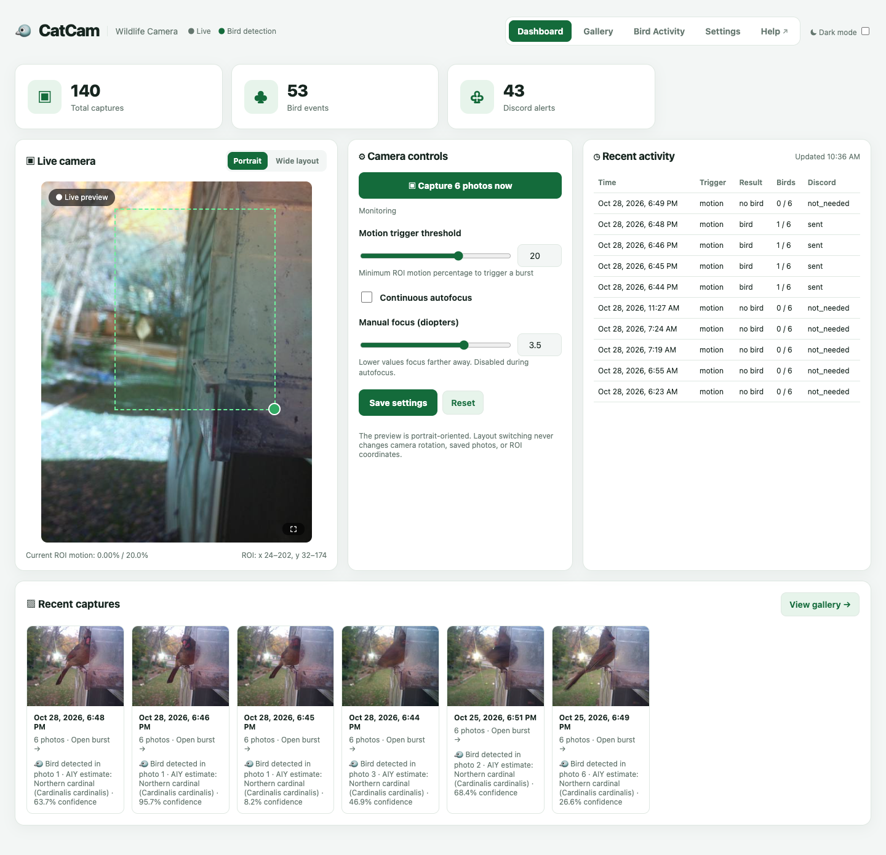

# CatCam User Guide

CatCam watches a bird feeder, records a six-photo burst when it sees motion, checks the photos for birds, and keeps the results in a gallery you can browse from any phone, tablet, or computer on your home network.

{ .catcam-hero }

-   :material-rocket-launch-outline: **New to CatCam?**

    ---

    Open the dashboard, check the live preview, and learn the basic controls.

    [:octicons-arrow-right-24: Getting started](getting-started.md)

-   :material-view-dashboard-outline: **Dashboard**

    ---

    Watch the live camera, adjust the motion area, and capture photos on demand.

    [:octicons-arrow-right-24: Use the dashboard](dashboard.md)

-   :material-camera-outline: **Gallery**

    ---

    Browse bursts, enlarge photos, and confirm which bird visited.

    [:octicons-arrow-right-24: Browse captures](gallery.md)

-   :material-chart-timeline-variant: **Bird Activity**

    ---

    See when birds visit, which species appear, and how activity changes over time.

    [:octicons-arrow-right-24: Explore bird activity](bird-activity.md)

## What CatCam does

1. **Watches a small area of the camera image.** This area is called the *region of interest*, or ROI. Only movement inside the dashed box counts.
2. **Records a burst of six photos.** Each burst is saved as one event, with six full-resolution photographs.
3. **Checks the photos for birds.** CatCam uses either Google Cloud Vision or a Local AI service on a Raspberry Pi 4.
4. **Keeps bird events and alerts you.** Bird-positive bursts are preserved and can be sent to Discord. Non-bird bursts are removed later by the cleanup schedule.
5. **Shows everything in your browser.** The Dashboard, Gallery, Bird Activity, and Settings pages all run on the camera itself.

!!! info "One burst = one event"
    A burst of six photos counts as **one capture event**, not six. Bird Activity counts events, so the numbers stay easy to read.

## The five main areas

| Area | What it is for |
| --- | --- |
| **Dashboard** | Live preview, motion readout, camera controls, recent activity, and recent captures. |
| **Settings** | Camera orientation, motion detection, detection engine, cleanup, thumbnails, timezone, and more. |
| **Gallery** | Every saved burst, with filters for birds, non-birds, date, hour, and bird type. |
| **Bird Activity** | Charts and tables of bird-positive events by day, hour, and species. |
| **Help** | This guide. The **Help** link in the CatCam header opens it in a new tab. |

## A note about the screenshots

Screenshots in this guide were taken from a working CatCam. Your own feeder, birds, dates, and counts will look different. The layout and controls are the same.

## Keeping this guide handy

- Open **Help** from the CatCam header at any time.
- The guide is hosted on GitHub Pages, so it also works when you are away from the camera.
- Use the search box at the top of this page to find a setting or message.
