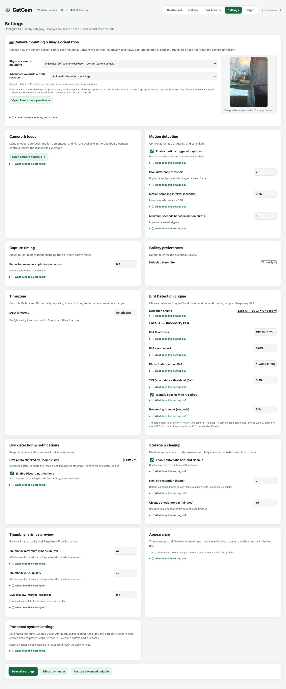
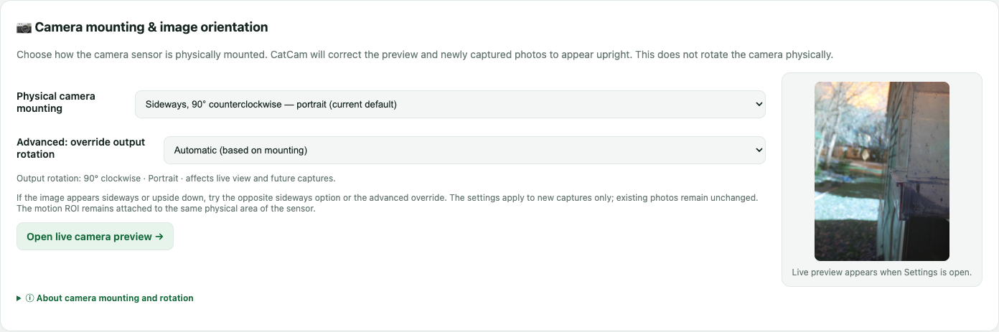

# Settings

The **Settings** page holds every camera and detection option that is not needed during everyday use. Changes are saved on the camera and survive restarts.

Open it from the header: **Settings**.

## How saving works

The settings page has its own buttons at the bottom:

| Button | What it does |
| --- | --- |
| **Save all settings** | Validates every field and saves all settings on the camera. |
| **Discard changes** | Reloads the saved values and throws away unsaved edits. |
| **Restore advanced defaults** | Asks for confirmation, then restores every setting on this page to its factory default. |

When a save succeeds, the status reads **Saved — changes are active**. If a number is outside its allowed range, the page highlights the field and asks you to correct it.

!!! warning "Restoring defaults can change cleanup"
    **Restore advanced defaults** resets the retention period and cleanup switches as well. Read the confirmation message before accepting.

!!! note "Camera controls are separate"
    The ROI, motion threshold, autofocus, and focus position are saved with **Save settings** on the [Dashboard](dashboard.md#camera-controls), not with the Settings page buttons. The Settings page links back to those controls.

## Camera mounting & image orientation

Use this section when the preview or saved photos appear sideways or upside down.

### Physical camera mounting

Choose how the camera is actually mounted:

| Option | Use when |
| --- | --- |
| **Normal — landscape** | The camera sits upright in its normal landscape position. |
| **Sideways, 90° clockwise — portrait** | The camera is rotated 90° clockwise. |
| **Sideways, 90° counterclockwise — portrait** | The camera is rotated 90° counterclockwise. This is the current default. |
| **Upside down — landscape** | The camera is mounted upside down. |

CatCam corrects the live preview and **new** captures. It cannot rotate photos that were already saved.

### Advanced: override output rotation

Leave this on **Automatic (based on mounting)** unless the automatic result is wrong. The manual choices are **0°**, **90°**, **180°**, and **270° clockwise**.

### Live orientation preview

The preview on the right appears while the Settings page is open. Use it to check the result before saving.

!!! tip "The ROI stays with the scene"
    The motion ROI is stored in the camera's native coordinates and transformed to match the live view. Changing orientation does not make the ROI point at a different part of the feeder.

## Camera & focus

This card is a shortcut. The manual focus, autofocus, motion percentage, and ROI controls live on the Dashboard. Press **Open camera controls →** to go there.

## Motion detection

| Setting | Default | Range | What it does |
| --- | --- | --- | --- |
| **Enable motion-triggered captures** | On | On / Off | Turns automatic motion captures on or off. Manual captures still work when off. |
| **Pixel difference threshold** | 20 | 1–255 | How different a pixel must be between frames to count as motion. Higher values ignore small changes. |
| **Motion sampling interval (seconds)** | 0.25 | 0.1–3 | How often frames are compared. Lower values react faster but use more CPU. |
| **Minimum seconds between motion bursts** | 5 | 0–3600 | Cooldown after a motion burst. Prevents repeated captures of the same movement. |

!!! tip "Two different thresholds"
    The **pixel difference threshold** on this page decides whether a pixel changed. The **Motion trigger threshold** on the Dashboard decides what percentage of the ROI must change. Adjust the Dashboard value first; change the pixel threshold only if the motion readout behaves unexpectedly.

## Capture timing

| Setting | Default | Range | What it does |
| --- | --- | --- | --- |
| **Pause between burst photos (seconds)** | 0.4 | 0–10 | Time between the six photos. The actual capture and save time is additional. |

The six-photo burst size is fixed. This setting changes the rhythm, not the number of photos.

## Gallery preferences

| Setting | Default | Options |
| --- | --- | --- |
| **Default gallery filter** | Birds only | Birds only, All bursts, No birds |

This chooses which filter the Gallery starts with. You can always change it on the Gallery page.

## Timezone

CatCam uses an **IANA timezone** such as `America/New_York` or `Europe/London`.

- It controls the dates and times shown in the Gallery and Bird Activity.
- Daylight saving time is handled automatically.
- Existing folder names on disk do not change.

Choose a value from the suggestion list or type a valid IANA name. An invalid name is rejected when you save.

## Bird Detection Engine

Choose how new bursts are classified.

### Google Cloud Vision

- Uses Google's cloud label detection.
- Counts against the CatCam Google Vision budget: **900 requests per calendar month**.
- The card shows requests used, the limit, and requests remaining for the current month.
- Stops checking a burst as soon as a bird is found, which conserves requests.

### Local AI — YOLO + AIY Birds

Runs detection on a separate Raspberry Pi 4 on your network. Local AI requests do not count against the Google Vision limit.

| Setting | Default | Notes |
| --- | --- | --- |
| **Pi 4 IP address** | `192.168.1.75` | Must be a valid IP address. |
| **Pi 4 service port** | `8765` | 1–65535. |
| **Photo folder path on Pi 4** | `/mnt/494USB/CatCam Wildlife` | Absolute path **on the Pi 4**, not on the camera. |
| **YOLO confidence threshold** | 0.25 | 0.05–0.95. Higher values require stronger confidence. |
| **Identify species with AIY Birds** | On | Adds a species estimate after a bird is detected. Estimates are not confirmations. |
| **Processing timeout (seconds)** | 120 | 15–300. How long to wait for the Pi 4. |

!!! info "Existing events keep their engine"
    Changing the engine affects **new** bursts. Old events retain the engine and result they were recorded with. If Local AI fails, the event is marked as an error; CatCam does not silently fall back to Google Vision.

## Bird detection & notifications

| Setting | Default | What it does |
| --- | --- | --- |
| **First photo checked by Google Vision** | Photo 1 | Checks that photo first, then wraps through the other five and stops at the first bird. |
| **Enable Discord notifications** | On | Sends bird-positive bursts to Discord. Also requires the Pi-side Discord toggle and a configured webhook. |

Discord alerts are **bird-only**. Non-bird bursts are never sent. The webhook credential is stored on the Pi and is not shown in the web interface.

## Storage & cleanup

CatCam can delete non-bird bursts automatically to save space.

| Setting | Default | Range | What it does |
| --- | --- | --- | --- |
| **Enable automatic non-bird cleanup** | On | On / Off | Turns automatic deletion on or off. Turning it off preserves photos and thumbnails. |
| **Non-bird retention (hours)** | 24 | 1–720 | How long a non-bird burst is kept before it becomes eligible for deletion. |
| **Cleanup check interval (minutes)** | 15 | 5–1440 | How often the cleanup worker looks for eligible bursts. |

Cleanup is deliberately cautious. It only deletes a burst when **all** of these are true:

- The burst has six photos.
- Classification is complete.
- The result is non-bird.
- The burst is older than the retention period.
- It has not been manually confirmed as a bird.

!!! warning "Lowering retention is immediate"
    If you lower the retention period, existing non-bird events can become eligible on the next cleanup check. Bird events and manually confirmed birds are never removed by this cleanup.

## Thumbnails & live preview

These settings trade image quality against Raspberry Pi performance.

| Setting | Default | Range | What it does |
| --- | --- | --- | --- |
| **Thumbnail maximum dimension (px)** | 420 | 160–1000 | Longest side of newly generated thumbnails. |
| **Thumbnail JPEG quality** | 72 | 40–95 | JPEG quality for new thumbnails. |
| **Live preview interval (seconds)** | 0.5 | 0.25–5 | How often the browser receives a new preview frame. |

Changes affect **new** thumbnails. Existing cached thumbnails are reused, so old images may keep their original size and quality. A lower preview interval updates more often but uses more CPU and bandwidth.

## Appearance

The light/dark theme and the Portrait/Wide dashboard layout are saved **in your browser**, not on the camera. Use the controls in the header and above the live preview.

These preferences do not change camera orientation or saved photographs. They also do not follow you to a different browser or phone.

## Protected system settings

Some values are intentionally fixed:

- **Six photos per burst.**
- **The 900-request monthly Google Vision budget.**
- **Bird classification rules.**
- **Bird-only Discord delivery.**

These protect capture records, cleanup safety, and API costs. The Discord webhook itself is never exposed through the web interface.

## Settings that need a restart

Most settings take effect immediately. A few behave differently:

- **Cleanup interval** changes after the current sleep period ends.
- **Mounting orientation** applies to the live view and new captures; existing photos are unchanged.
- **Thumbnail settings** apply to new thumbnails only.

If a change does not seem to apply, save again, reload the page, and check [Troubleshooting](troubleshooting.md).
